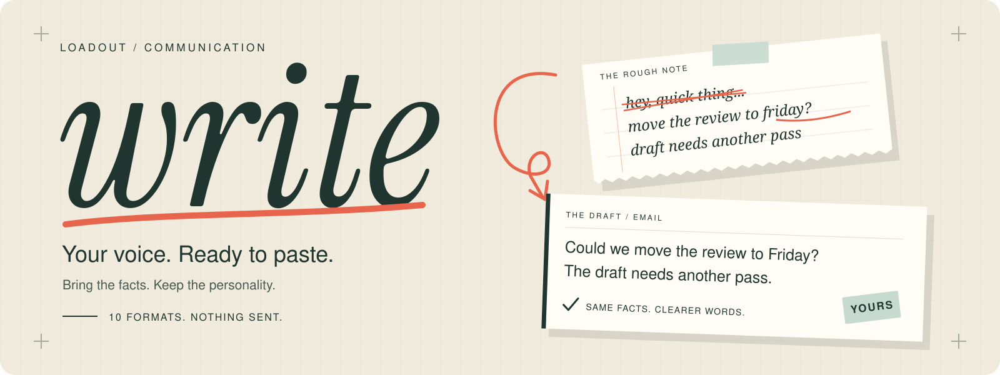

<p align="center">
  
</p>

# write skill

Drafts Slack messages, emails and PR comments (Ghostwriter rules), PR titles and bodies (pr-creator rules), commit messages (repository conventions), and release notes, postmortems, tickets, articles and docs (Sepia rules) in the user's voice. Optional questionnaire onboarding builds user-approved local profiles. It never sends, posts, commits, pushes, rebases or edits PRs.

## Layout

| Path | What |
|---|---|
| `SKILL.md` | The skill: routing, workflow, revision budget, attribution rules |
| `references/slack.md`, `email.md`, `pr-comment.md`, `tells.md` | Ghostwriter rule sets (adapted) |
| `references/commit.md` | Commit message card: convention comes from repo evidence |
| `references/professional.md`, `release-notes.md`, `postmortem.md`, `ticket.md`, `article.md`, `docs.md` | Professional-document rule set (Sepia, adapted; docs card is local) |
| `references/pr.md` | PR rule set (pr-creator, adapted, drafting only) |
| `references/review.md` | Pre-finalize review, independent review packet, post-finalize meaning recheck |
| `references/voice.md` | Voice data root, approval rules for profiles and `rules.json` |
| `references/onboarding.md` | Guided questionnaire, optional comparisons, example persona and approval before saving |
| `scripts/write_runner.py` | `route`, `voice`, `snapshot`, `finalize` (stdlib only) |
| `PROVENANCE.md`, `THIRD_PARTY_NOTICES.md` | Pinned upstream revisions, local changes, MIT notices |
| `config/claude-settings.json` | Attribution source-off for Claude Code, passed per run with `--settings` |
| `tests/test_gates.py`, `tests/fixtures/` | Correctness gates; all fixtures are synthetic |

## Run the gates

From this skill's directory:

```sh
python3 -m unittest discover -s tests -v
```

## Use without installing

Claude Code, project-scoped (no global install): symlink or copy this skill directory to `<project>/.claude/skills/write`, then run `claude --settings <skill directory>/config/claude-settings.json`.

Codex: point it at `SKILL.md` in the prompt, or copy the directory to `~/.codex/skills/write` and invoke `$write`. Codex attribution is account/workspace policy with no verified local switch; it only applies to commits and PRs Codex creates, which this skill never does.

## Voice data

Lives in `$GHOSTWRITER_HOME` (default `~/.config/ghostwriter`), never in this repo. `rules.json` there holds the user's mechanical bans. With none, no punctuation is banned. Imports under `imports/` are unapproved candidate evidence.

No author's persona ships with the skill. Without a profile, the channel cards provide general editorial guidance. To build your own, ask `$write set up my voice` in Codex, or `/loadout:write set up my voice` in the Claude Code plugin. The [questionnaire](references/onboarding.md) covers shared preferences and the channels you choose, with optional writing samples or paired examples. You review the proposed `persona.md` and channel files before anything is saved. Setup can be skipped or resumed later.

When drafting, the skill reads `soul.md` if present, then the selected channel profile and any shared persona it references. Without a channel profile, it falls back to `persona.md` (or `$GHOSTWRITER_PERSONA`). Questionnaire answers and evaluation ratings are not automatically used as drafting instructions.
